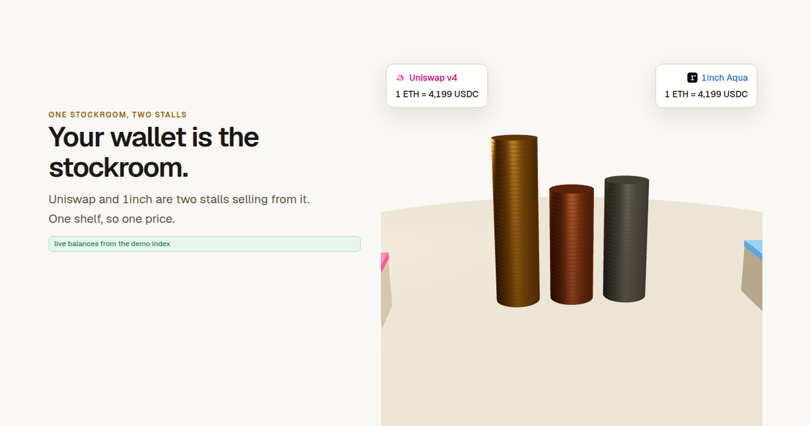
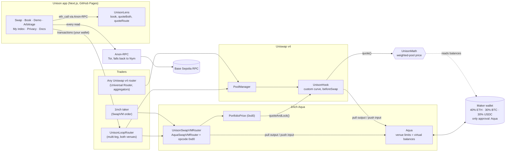
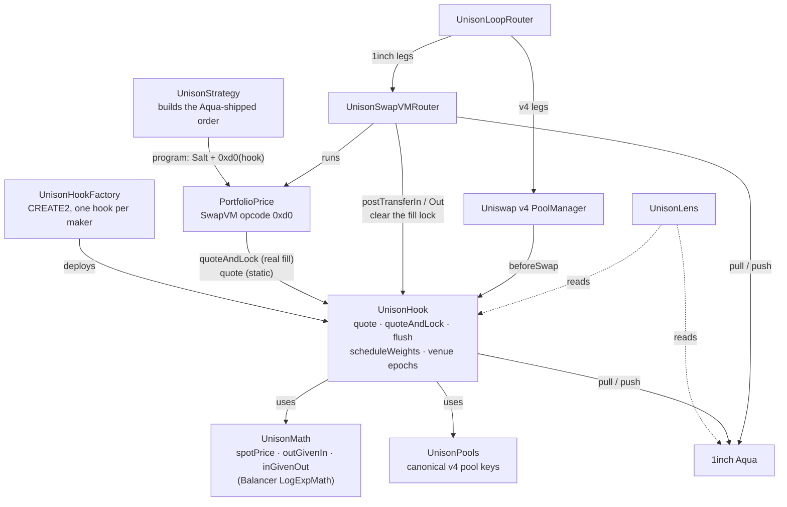
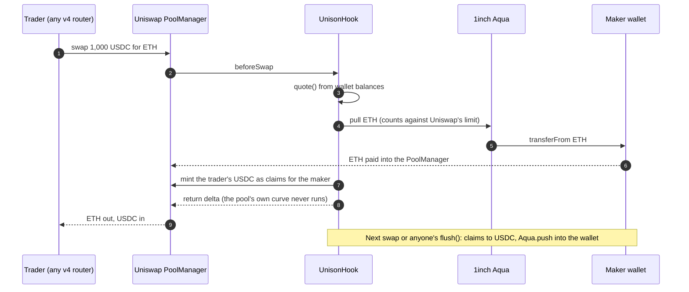
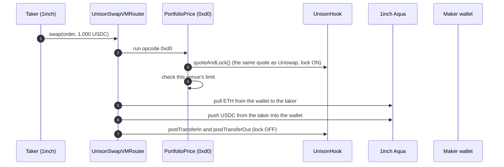
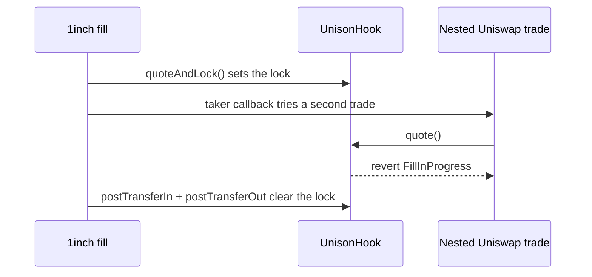
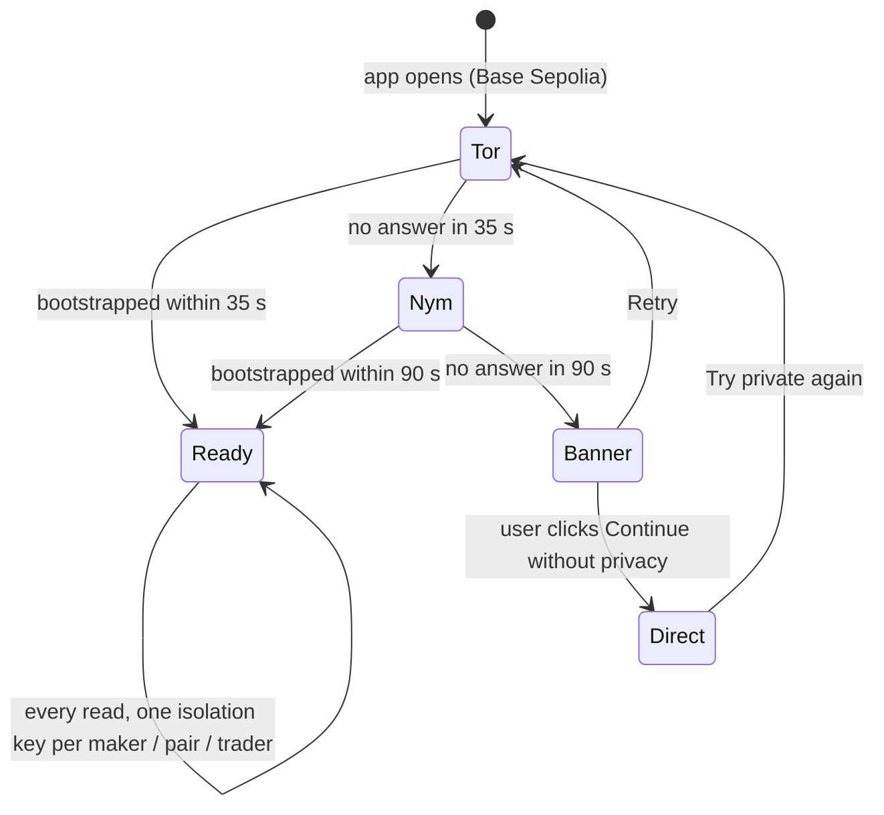
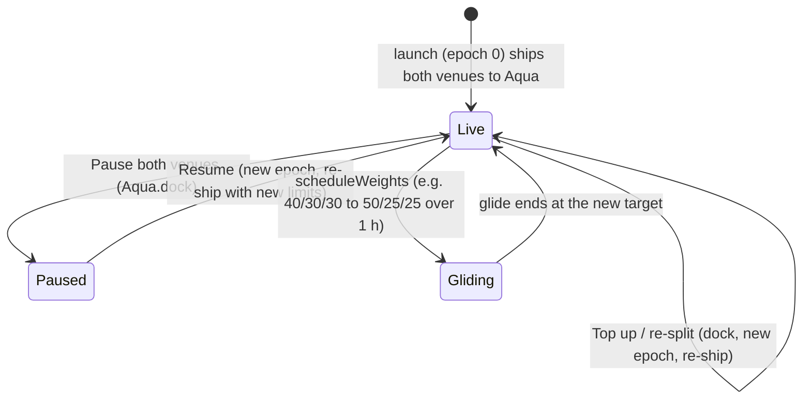
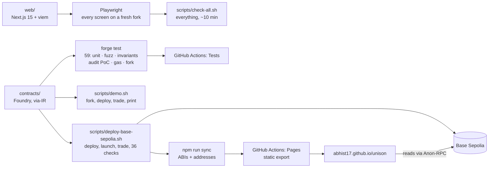

# Unison

[](https://github.com/Abhist17/unison/actions/workflows/test.yml) [](https://abhist17.github.io/unison/)

**One wallet, one price, every venue, nobody watching.**



> **Stop splitting your coins across exchanges.** Unison turns one self-custodial wallet into a weighted index (for example 40% ETH / 30% BTC / 30% USDC) that **Uniswap v4** and **1inch Aqua** both trade, from the same coins, at the same price, with no oracle, while the dashboard reads the chain privately through the Ethereum Foundation's **Anon-RPC**.

| | |
| --- | --- |
| **Same price on both venues** | 0 wei apart: a Uniswap v4 hook and a 1inch SwapVM instruction call one pricing function over one wallet |
| **Can't be arbitraged** | any loop through the wallet loses (−0.81% for 1 ETH across both venues) |
| **Manages itself** | traders bring it back to 40/30/30 and pay it the fee; changing the mix gradually costs $25 instead of $1,991 |
| **Nobody watching** | every read through Anon-RPC (Tor, then Nym), one isolation key per maker, pair and trader |
| **Live** | [abhist17.github.io/unison](https://abhist17.github.io/unison/) on Base Sepolia · [docs](https://abhist17.github.io/unison/docs/) · [plain-words explainer with diagrams](docs/explained.md) |

In music, *unison* means every voice on the same note at the same time: both venues, one price, the same moment. Built at ETHGlobal (5–7 Nov 2026).

**Try it in one command** (needs Foundry and Node):

```bash
git clone --recursive https://github.com/Abhist17/unison && cd unison && (cd contracts && npm ci) && (cd web && npm ci) && ./scripts/demo.sh
```

It forks Base Sepolia, deploys, launches a 40/30/30 index, trades on both venues, prints the on-chain numbers (0 wei apart; the arbitrage loop loses) and opens the app. About 5 minutes on a first run (clone, installs, compile); verified from a fresh clone of this repo. [docs/demo.md](docs/demo.md) walks through it.

**New here?** [docs/explained.md](docs/explained.md) explains every part in plain words, with diagrams: the trade on each venue, why prices match, why loops lose, rebalancing, limits, the fill lock, privacy, every screen and contract.

## Live on Base Sepolia

**App:** https://abhist17.github.io/unison/ · every read goes through Anon-RPC · the demo index has real fills on both venues · 36/36 on-chain checks (`./scripts/smoke.sh base-sepolia`).

| Contract | Address | What it is |
| --- | --- | --- |
| Demo index (UnisonHook) | [`0xb6879F5F560597B7C1dbfA176c4ac6928Eac6888`](https://sepolia.basescan.org/address/0xb6879F5F560597B7C1dbfA176c4ac6928Eac6888) | the live 40/30/30 index: trade it on either venue |
| UnisonHookFactory | [`0x2F4578C47671b7147908BB9A46a6F8E48c51B18D`](https://sepolia.basescan.org/address/0x2F4578C47671b7147908BB9A46a6F8E48c51B18D) | one hook per maker |
| UnisonSwapVMRouter | [`0x758fFD698fF6A7662ad3094eF3d644f436F1db93`](https://sepolia.basescan.org/address/0x758fFD698fF6A7662ad3094eF3d644f436F1db93) | 1inch AquaSwapVMRouter + opcode 0xd0 |
| Aqua | [`0x78999A40d392C402b743b810De4c5DbFdD370239`](https://sepolia.basescan.org/address/0x78999A40d392C402b743b810De4c5DbFdD370239) | 1inch Aqua (official source, redeployed: not on testnets) |
| UnisonLens | [`0xe0410dAE32b3cA5f966B13FC6Ee4D8c274F9ca5b`](https://sepolia.basescan.org/address/0xe0410dAE32b3cA5f966B13FC6Ee4D8c274F9ca5b) | whole book, quotes on both venues, previews |
| UnisonLoopRouter | [`0xcA34ABc7f1D6b488cecf3Af6d5E57434cF671b25`](https://sepolia.basescan.org/address/0xcA34ABc7f1D6b488cecf3Af6d5E57434cF671b25) | multi-leg trades across both venues |
| PoolManager | [`0x05E73354cFDd6745C338b50BcFDfA3Aa6fA03408`](https://sepolia.basescan.org/address/0x05E73354cFDd6745C338b50BcFDfA3Aa6fA03408) | official Uniswap v4 |
| Test tokens | [tWETH](https://sepolia.basescan.org/address/0xc0a02AdD604782C723D170d87aE8bFC478ce53D2) · [tWBTC](https://sepolia.basescan.org/address/0x44F7330F03c46aa75135E757DB320370208fdcCC) · [tUSDC](https://sepolia.basescan.org/address/0xc931D7EA4a7102E3F16173b077A4c26671Dab54d) | tWETH / tWBTC / tUSDC (no value) |

## Architecture

### System overview

Who talks to what. Both venues ask **one** price function (`UnisonHook.quote()`) over **one** wallet; coins only ever move through 1inch Aqua, the wallet's single approval. The app reads everything privately through Anon-RPC.



### Contract map

What each contract is for and how they connect (arrows: *deploys*, *calls*, *reads*).



### A trade on Uniswap v4



### A trade on 1inch Aqua



### The fill lock (security finding C-1, fixed)

SwapVM calls the taker back *after* pricing and *before* moving coins. A trade nested in that gap would price on stale balances, so pricing is locked for the whole fill:



Proof of concept: honest trades lose $39.54 in fees; the nested attack gained $752.92 before the fix and reverts after it. See [AUDIT.md](AUDIT.md).

### Private reads



Nothing is ever read directly unless the user chooses it, and every such read is logged as `direct (not private)`.

### Venue lifecycle



### Build, test and ship



## What to remember

| Claim | Evidence (this repo's tests) |
| --- | --- |
| **One inventory, two venues.** A v4 hook and a custom 1inch SwapVM instruction call the same pricing function over the wallet's real balances. | 0 units of difference between venues, all 6 directions, exact-in and exact-out (`CrossVenue.t.sol`). Official **V4Quoter** on Base Sepolia returns exactly the hook's quote (`test/fork`). |
| **It can't be gamed.** Any loop through the wallet, on one venue or across both, loses. | 3-leg loop ETH→USDC (Uniswap) → BTC (1inch) → ETH (Uniswap) of 0.1 ETH loses **88 bps**; fuzzed loops over any venue mix always lose; round trips lose at least the proven floor `a·f·B/(B + a(1−f))`. |
| **It rebalances itself.** When the market moves, traders buy what is cheap from you until the mix is back on target. | ETH 4,000 → 5,000, arbitrage alone restores **40.01 / 29.99 / 29.99**. |
| **New: change your allocation without paying to rebalance.** `scheduleWeights` glides the target weights on both venues at once, so the market walks the wallet to the new mix through small, fee-paying trades. | Moving a $100k index 40/30/30 → 50/25/25 at constant prices: instant switch costs **$1,991** to arbitrage, a 50-step glide costs **$25**; both reach 50% ETH (`Reweight.t.sol`). |
| **The maker stays in control.** Pause both venues in one click; resume, top up or re-split under a new epoch. | `Manage.t.sol`: pause stops both venues and leaves the wallet untouched; resume re-opens both with identical quotes. |
| **Nobody watches you.** | 100% of app reads go through Anon-RPC (Tor by default) on Base Sepolia, keys per maker / strategy / trader, live read log, logging proxy. |
| **Honest limit.** Unison does not reduce LVR against the outside market. The traders who rebalance you capture the move; you earn the fee. | The landing page states the cost: at ETH $6,400 a $100k index trails holding by ~$3,316 before fees. |

## Pitch

**One-liner.** A self-custodial index wallet quoted on Uniswap v4 and 1inch Aqua at once, priced on both from the same real balances with oracle-free index math, run from a dashboard nobody can watch.

**30 seconds.** A market maker quoting on two venues usually splits its capital and keeps two inconsistent sets of prices. Unison turns one self-custodial wallet into a 40/30/30 weighted index quoted on both Uniswap v4 and 1inch Aqua. Both venues price every trade from the same wallet balances, so a fill on one venue moves the other venue's quote immediately, loops against the maker always lose, and trader flow pulls the wallet back to its target weights. There is no oracle and no tuning knob. The maker's dashboard reads everything through EF's Anon-RPC, so no RPC provider learns who runs the book or what it watches.

**In plain words (Raju's shop).** Raju keeps mangoes, rice and cash in one stockroom and opens two stalls in two markets. Both stalls sell from the same stockroom and read prices off one board whose rule keeps the stock at 40/30/30: too many mangoes makes mangoes cheaper until customers buy them back down. A sale at one stall changes the price at the other immediately, so nobody can buy cheap at one stall and sell dear at the other, and no loop through his products makes free money.

## For judges: where to look

| Track | What to read | Proof |
| --- | --- | --- |
| **Uniswap v4** (Build with Uniswap) | [UnisonHook.beforeSwap](https://github.com/Abhist17/unison/blob/main/contracts/src/UnisonHook.sol#L393): prices from the wallet, cancels the AMM with a return delta; [input minted as ERC-6909 claims](https://github.com/Abhist17/unison/blob/main/contracts/src/UnisonHook.sol#L415); [output paid via Aqua.pull into the PoolManager](https://github.com/Abhist17/unison/blob/main/contracts/src/UnisonHook.sol#L421); [claims flushed into the wallet via Aqua.push](https://github.com/Abhist17/unison/blob/main/contracts/src/UnisonHook.sol#L468); [no LP deposits](https://github.com/Abhist17/unison/blob/main/contracts/src/UnisonHook.sol#L385); [maker-only pools, index tokens only](https://github.com/Abhist17/unison/blob/main/contracts/src/UnisonHook.sol#L370) | [official V4Quoter == hook quote](https://github.com/Abhist17/unison/blob/main/contracts/test/fork/V4BaseSepolia.t.sol#L61) and [real Universal Router swap pays from the wallet](https://github.com/Abhist17/unison/blob/main/contracts/test/fork/V4BaseSepolia.t.sol#L72) on Base Sepolia; [`FEEDBACK.md`](FEEDBACK.md) |
| **1inch** (Build an Aqua App) | [PortfolioPrice.exec](https://github.com/Abhist17/unison/blob/main/contracts/src/aqua/PortfolioPrice.sol#L28) (custom SwapVM opcode `0xd0`, [Aqua virtual balance = venue limit](https://github.com/Abhist17/unison/blob/main/contracts/src/aqua/PortfolioPrice.sol#L42)); [UnisonSwapVMRouter._runOpcode](https://github.com/Abhist17/unison/blob/main/contracts/src/aqua/UnisonSwapVMRouter.sol#L16) (official AquaSwapVMRouter + one opcode); [the Aqua-shipped order](https://github.com/Abhist17/unison/blob/main/contracts/src/aqua/UnisonStrategy.sol#L22) | [venue limit](https://github.com/Abhist17/unison/blob/main/contracts/test/PortfolioPrice.t.sol#L48), [refuses another maker's hook](https://github.com/Abhist17/unison/blob/main/contracts/test/PortfolioPrice.t.sol#L57); real Aqua push/pull transfers in `test_swap_realPushPull_throughAqua` |
| **EF** (Best Use of Anon-RPC) | [rpc(): the app's only read path](https://github.com/Abhist17/unison/blob/main/web/src/lib/anon.ts#L214); [one viem client per isolation scope](https://github.com/Abhist17/unison/blob/main/web/src/lib/anon.ts#L274); [isolation keys: maker / strategy / trader / public](https://github.com/Abhist17/unison/blob/main/web/src/lib/anon.ts#L289); [the one bootstrap read, logged as such](https://github.com/Abhist17/unison/blob/main/web/src/lib/anon.ts#L78); [Tor -> Nym fallback, never to passthrough](https://github.com/Abhist17/unison/blob/main/web/src/lib/anon.ts#L106); [`proxy/server.mjs`](proxy/server.mjs) | Privacy screen: every read with route, label, isolation key and latency; "Test the route" reads Base Sepolia through the mixnet |
| **Shared math** | [outGivenIn](https://github.com/Abhist17/unison/blob/main/contracts/src/libraries/UnisonMath.sol#L130), [inGivenOut](https://github.com/Abhist17/unison/blob/main/contracts/src/libraries/UnisonMath.sol#L151), [spotPrice](https://github.com/Abhist17/unison/blob/main/contracts/src/libraries/UnisonMath.sol#L119), [bounded pow](https://github.com/Abhist17/unison/blob/main/contracts/src/libraries/UnisonMath.sol#L66) | [80-digit reference vectors](https://github.com/Abhist17/unison/blob/main/contracts/test/UnisonMath.t.sol#L50) |

## Threat model → tests

| Risk | Defence | Test |
| --- | --- | --- |
| Loops through the maker's pairs or across venues | Invariant math: every loop loses (fees only add to the wallet; rounding favours the maker), with a proven per-round-trip floor | [3-leg cross-venue loop](https://github.com/Abhist17/unison/blob/main/contracts/test/CrossVenue.t.sol#L57), [fuzzed loops over any venue mix](https://github.com/Abhist17/unison/blob/main/contracts/test/CrossVenue.t.sol#L79), [round-trip floor (fuzzed)](https://github.com/Abhist17/unison/blob/main/contracts/test/UnisonMath.t.sol#L93) |
| Inconsistent prices between venues | One `quote()` for both | [0 units difference, 6 directions × 2 modes](https://github.com/Abhist17/unison/blob/main/contracts/test/CrossVenue.t.sol#L15), [a fill moves the other venue](https://github.com/Abhist17/unison/blob/main/contracts/test/CrossVenue.t.sol#L40) |
| Donating tokens to move the price | Donations only enrich the maker | [donate-then-swap never profits (fuzzed)](https://github.com/Abhist17/unison/blob/main/contracts/test/UnisonMath.t.sol#L141) |
| Approval scope | The maker approves **only Aqua** (tighter than the original "Aqua and the hook" plan) | [no allowance to hook, router or PoolManager](https://github.com/Abhist17/unison/blob/main/contracts/test/CrossVenue.t.sol#L125) |
| Venue over-draw | Aqua virtual balances cap each venue; hook checks its own cap | [Uniswap venue stops at its cap](https://github.com/Abhist17/unison/blob/main/contracts/test/UnisonHook.t.sol#L71), [1inch venue stops at its cap](https://github.com/Abhist17/unison/blob/main/contracts/test/PortfolioPrice.t.sol#L48) |
| Someone points an order at your hook | Instruction checks `pricer.maker() == order.maker` | [refused](https://github.com/Abhist17/unison/blob/main/contracts/test/PortfolioPrice.t.sol#L57) |
| Rounding | Every step rounds toward the maker | [maker-side vs 80-digit reference](https://github.com/Abhist17/unison/blob/main/contracts/test/UnisonMath.t.sol#L50) |
| Unrelated funds in the wallet | Use a dedicated maker wallet (stated in the app) | documented |
| RPC metadata leaks | All reads through Anon-RPC; bootstrap read and transactions documented as exceptions | Privacy screen |

## Questions we set out to answer (and what we found)

- **Can a contract other than the SwapVM router (our v4 hook) act as an AquaApp and `pull`/`push`?** Yes. Aqua keys balances by `msg.sender` as the app, so the hook ships its own strategy and pulls/pushes inside the v4 swap. No direct-approval fallback was needed.
- **Can a custom SwapVM instruction use the maker's real balances?** Yes: opcode `0xd0` calls the hook's `quote()`, which reads the wallet's ERC-20 balances plus pending claims; SwapVM's preloaded Aqua balances become the venue cap.
- **Does the Universal Router / quoter work with a custom-curve hook pool?** Yes, unchanged: the fork tests use the live V4Quoter and Universal Router on Base Sepolia.
- **Which Anon-RPC network reaches our testnet?** Nym did (Base Sepolia reads in ~6 s, 6 Nov 2026). The EF demo Tor gateway was unreachable that day, so the app falls back from Tor to Nym automatically.

## Prior art and how Unison differs

| Area | Closest prior work | Unison |
| --- | --- | --- |
| Aqua apps | ScubaSwap, Batas, Plimsoll, AquaPilot / Sluice, KSwap-VM, Aqua0 | None prices from shared portfolio balances or links Aqua to Uniswap v4 |
| v4 hooks sourcing outside liquidity | Uniswap's aggregator hooks; Iceberg (ETHGlobal Tokyo 2026: v4 hook + Aqua at one price) | A self-custodial multi-token index that self-rebalances through trader flow, with private monitoring; no LVR claim |
| Weighted pools | Balancer | Same math, but self-custodial, multi-venue and wallet-native |

## How it works

Every quote on both venues comes from one weighted-pool formula over the wallet's real balances
(`w` = target weight, `B` = balance held, `f` = 0.30% flat fee):

```
spot price of i in j      p = (w_i / w_j) · (B_j / B_i)
tokens out for input a    out = B_j · (1 − (B_i / (B_i + a(1−f)))^(w_i / w_j))
```

- **One inventory.** Both venues read the same balances. A fill on Uniswap changes the wallet, so the very next 1inch quote reflects it, and the other way round.
- **Loops lose.** Without fees every trade preserves the invariant ∏B^w, so a loop that returns to its start token returns exactly what went in. Fees only add to the wallet and every rounding step favours the maker.
- **Self-rebalancing.** At Unison's own prices a weighted pool is always on target. When the outside price moves by `k`, arbitrage leaves `B_ETH·k^(w−1)` ETH and `B_j·k^w` of each other token: back on weight by value.
- **Limits.** One trade moves at most 30% of a balance (keeps the fixed-point `pow` accurate). Each venue has its own selling limit, enforced by Aqua (50% of each balance at launch).

The diagrams in [Architecture](#architecture) show the same thing in detail.

## Contracts (`contracts/src`)

| Contract | Venue | What it does |
| --- | --- | --- |
| `libraries/UnisonMath.sol` | both | Spot price, exact-in / exact-out quotes, weight & fee checks, decimals. Fixed point, every rounding step in the maker's favour. Uses Balancer v3's `LogExpMath` (MIT) for `pow`. |
| `UnisonHook.sol` | Uniswap v4 | Custom-curve hook. `beforeSwap` prices from the wallet and cancels the AMM with a return delta. Pays the trader straight out of the wallet (`sync` → `Aqua.pull` into the PoolManager → `settle`). The trader's input is minted as ERC-6909 claims held for the maker, counted as inventory immediately, and moved into the wallet via `Aqua.push` on the next swap or a permissionless `flush()` (transient storage stops it flushing input paid in the same tx). Blocks LP deposits; only the maker can create pools, only for index tokens. Exposes `quote()`, `price()`, `effectiveBalance()` for both venues. |
| `UnisonHookFactory.sol` | Uniswap v4 | CREATE2 factory, one hook per maker; the dashboard mines the hook address in the browser. |
| `aqua/PortfolioPrice.sol` | 1inch Aqua | Custom SwapVM instruction (opcode `0xd0`, in the unallocated `0xd0–0xef` bank). Keeps Aqua's virtual balance as this venue's selling limit, prices through the hook's `quote()`, refuses a hook that belongs to another maker. |
| `aqua/UnisonSwapVMRouter.sol` | 1inch Aqua | The official `AquaSwapVMRouter`, unchanged, plus one opcode. 22.8 KB runtime (< 24 KB). |
| `aqua/UnisonStrategy.sol` | 1inch Aqua | Builds the Aqua-shipped SwapVM order for a pair: optional stock `Salt`, then `PortfolioPrice(hook)`. |
| `UnisonLens.sol` | app | The whole book in one call, quotes from both venues in one `eth_call`, exact multi-leg route quotes. |
| `UnisonLoopRouter.sol` | app | Runs a multi-leg route across both venues in one transaction (the "Arbitrage me" demo). |
| `UnisonTestToken.sol` | testnet | Clearly labelled faucet tokens (tWETH, tWBTC, tUSDC). |

Pinned dependencies: `swap-vm` main @ `e91dea5`, `aqua` `v1.0.2-rc.2`, `@1inch/solidity-utils` 7.0.3,
`v4-periphery` main (with `v4-core`). Aqua and SwapVM are not deployed on any testnet, so the deploy
script deploys the official Aqua source and the Unison router on Base Sepolia; Uniswap v4 (PoolManager,
V4Quoter, Universal Router, Permit2) is the real Base Sepolia deployment.

## Tests

```bash
cd contracts
npm install                                  # @1inch/solidity-utils, @openzeppelin (as upstream does)
git submodule update --init --recursive
npm run build:v4                             # builds the real v4 PoolManager artifact (solc 0.8.26)
forge test --no-match-path 'test/fork/*'     # 57 tests (incl. invariant suite, audit PoC, gas)
forge test --match-path 'test/fork/*'        # 2 fork tests against live Uniswap v4 on Base Sepolia
python3 reference/unison_math.py              # regenerates the 80-digit reference vectors
```

| Suite | Covers |
| --- | --- |
| `UnisonMath.t.sol` | 111 vectors from an 80-digit Python reference (within 3×10⁻¹⁴ of balance, always on the maker's side); fuzzed round-trip floor; fee-free invariant never decreases; donation-then-swap never profits; guards. |
| `UnisonHook.t.sol` | Pays from wallet, prices from wallet, exact-out, claims flush via Aqua (re-crediting the venue limit), permissionless flush, a token cannot leave the index with claims pending, venue limit stops at the Aqua cap while the wallet keeps the rest, no LP, maker-only pools, scoped approvals. |
| `PortfolioPrice.t.sol` | Program layout, quote == hook quote, real Aqua push/pull, exact-out, venue limit = Aqua virtual balance, refuses another maker's hook. |
| `CrossVenue.t.sol` | Same price (6 directions × 2 modes), fills move the other venue, loops lose (fixed + fuzzed), self-rebalancing, only Aqua is approved. |
| `Reweight.t.sol` | Weights glide linearly and both venues follow; gradual vs instant re-weight cost with a fee-aware arbitrageur. |
| `Manage.t.sol` | Pause stops both venues (wallet untouched); resume with a top-up under a new epoch; epoch 0 orders unchanged. |
| `invariant/UnisonInvariant.t.sol` | 64 runs × 40 random actions (swaps on both venues, exact-in/out, flushes, donations): same price both venues, wallet changes only by fills, claims fully backed, invariant never falls, only Aqua approved. |
| `audit/CrossVenueReentrancy.t.sol`, `audit/FillLock.t.sol` | Audit finding C-1: the callback double-dip PoC (now blocked) and the fill-lock guarantees. See [AUDIT.md](AUDIT.md). |
| `LensLoop.t.sol` | A cross-venue loop returns exactly its Lens quote leg by leg; quoteBoth; book; minOut. |
| `fork/V4BaseSepolia.t.sol` | Official V4Quoter == hook quote; a real Universal Router swap pays from the maker wallet. |
| `Gas.t.sol` | What each action costs, with regression bounds: Uniswap v4 swap ~290k gas (incl. the test router), 1inch Aqua fill ~216k, flush ~143k, `quote()` ~52k (measured in-test, before refunds, excluding the 21k base). |

**Everything in one command:** `./scripts/check-all.sh` runs the contract tests (including fork tests), the web typecheck and lint, a fresh fork with deploy, the 36 smoke checks, 27 headless user flows and the 18 browser specs (about 10 minutes). CI runs the offline contract suite and the web checks on every push.

**Browser tests** (Playwright, system Chrome, no browser download). `cd web && npm run e2e` boots a fresh Base Sepolia fork, deploys, and drives the real app with an injected wallet backed by anvil's dev accounts:

| Spec | Proves |
| --- | --- |
| `01-landing` | The hook sentence, the live price board (both venues equal, 0 wei), the shop story, the receipts, no console errors |
| `02-create` | Weights always sum to 100%; preview equals the contracts' math |
| `03-launch` | Six real launch transactions; a reload mid-launch resumes from chain state |
| `04-book` | Identical quotes per pair; a fill on one venue moves the other; flush; venue limits |
| `05-arbitrage` | A 3-leg cross-venue loop returns exactly its quote, and loses |
| `06-privacy` | Every read listed with route and isolation key |
| `07-screens` | Swap, Explore, My index, How it works, light and dark |
| `08-demo` | Guided demo runs for real, resumes after reload, reruns without duplicates |
| `09-manage` | Gradual re-weight glides on chain time; top up raises a venue limit |
| `10-share` | Share card shows on-chain data; links keep the picked index |
| `11-mobile` | All 12 pages fit a 390 px phone; both menus work |
| `12-explain` | Every main page's "How this page works" box opens and links to the explainer |
| `13-a11y` | Skip link is the first tab stop; keyboard focus is visible; the nav marks the current page; every image has alt text |
| `14-gas` | A wallet with no ETH is told how to get gas (faucet links on Base Sepolia) on Demo, Swap and Launch; a funded wallet never sees it |
| `15-wallet` | Switching accounts in the browser wallet updates the app; disconnecting there disconnects here |
| `16-docs` | Docs render, code blocks copy, this build's contract addresses show, every section link resolves |
| `17-charts` | Charts tell the truth: Uniswap and 1inch identical at every trade size, every loop size loses, hold vs Unison, read latency |
| `18-features` | Move the market (traders act, the wallet earns a fee), a real swap ends with a receipt 0 wei apart from the other venue, fees and volume per venue, Explore sparklines |

`npm run e2e:testnet` checks the deployed site instead: reads really go through Anon-RPC (Tor, falling back to Nym) to Base Sepolia, and every chain screen either works or (before the contracts are deployed) explains itself with a labelled screenshot. Screenshots land in `web/e2e/artifacts/`.

## The app (`web/`)

Next.js 15 + viem (charts are plain SVG). Everything shown comes from the chain or is labelled *simulated* / *example*.
Every transaction gets a toast (confirm in wallet → submitted, with explorer link → confirmed), and contract
reverts are decoded into plain sentences ("Trade too large: one trade can move at most 30% of a balance").

- **Landing:** the hook ("Stop splitting your coins across exchanges."), a live price board (one wallet, both venues quoting the same trade, 0 wei apart), the idea told as a shop (Today vs With Unison, one shelf, the trade flow), the real `demo.sh` receipts, a checklist where every claim links to its test, what we checked and what it doesn't do, a developer teaser and an FAQ.
- **Charts** (plain SVG, hover tooltips, a table view on each): Book, *same price at every size* (both venues quoted live at 9 sizes, the lines coincide), *depth read from the wallet* (how much ETH it buys or sells at each price, capped at venue limits) and *ETH price fill by fill* (every real fill, by venue); Arbitrage, *any size loses* (your loop quoted at 6 sizes); My index, *Unison vs just holding* as ETH moves (pool formula, LVR shown honestly); Privacy, *time per read*.
- **Move the market** (Book): drag ETH's outside price; a chart shows the wallet's ETH share *if nobody traded* drifting away from target and *after traders rebalance* staying on it, with what traders would do, their profit and the fee the wallet earns. The slider drives the live rebalancing panel below it.
- **Trade receipt** (Swap): after a real swap, a card with what you received (read from the trade's own event), what the other venue quoted for the same trade (0 wei apart), the transaction link, *Copy to share* and *Share on X*.
- **Fees and volume** (My index): fees earned per venue, fill by fill, and volume by venue. **Explore** cards show each index's fills, fees and a sparkline of its fill prices.
- **Docs** (`/docs`): quickstart, run the app, deploy to Base Sepolia, launch an index, quote both venues, trade (router, Uniswap v4 pool key, 1inch order), private reads, contracts with this build's addresses, tests and limits; every code block has a copy button.
- **Swap:** the everyday screen. Pay / receive, both venues' quotes side by side (identical, with each venue's remaining limit), rate, price impact, fee, minimum received (0.5% slippage), and one button that walks you through *get test tokens → approve → swap*. Defaults to the demo index so you trade against a real counterparty; makers can switch to their own.
- **Create:** assets and weights (always sum to 100%), quote preview per pair computed by the contracts' own math (`UnisonLens.previewSpot` / `previewOutGivenIn`).
- **Launch:** six real steps from your wallet (deploy your own hook with an address mined in the browser, test tokens, approve Aqua only, set weights, open v4 pools + ship the Uniswap venue, ship 1inch Aqua strategies). Each step resumes from chain state.
- **Explore:** every index launched through the factory (read from its events): value, weights, live/paused, with Trade and Live book links (`?index=0x…`).
- **My index** (the maker's home): performance vs just holding (start reconstructed from fills), fees earned, volume per venue; change allocation instantly or gradually (1 hour to 3 days) with the measured cost difference; pause both venues, resume, top up or re-split.
- **Live book:** weights vs target, a live rebalancing panel at the market prices you type (what the wallet will buy/sell, arbitrage available, "be that trader" → prefilled Swap), identical quotes on both venues per pair, remaining venue limits, one fill feed for both venues, fees earned, flush button.
- **Arbitrage me:** build any route across venues, quote it exactly, run it for real.
- **Privacy:** every chain read live (route, label, isolation key, latency), worker switcher (Tor / Nym / passthrough), who-learns-what, logging-proxy view.
- **Demo:** a guided six-step tour from your wallet, labelled demo mode (test tokens → approve → parity check → one trade per venue → losing loop). Real transactions; steps already done on chain are skipped; progress resumes after a reload.
- **Share:** a card for any index (`/share?index=0x…`): on-chain weights, spot prices, fill count, and a link to trade it.
- **Explanations:** every main screen has a collapsed "How this page works" box linking to its section of [docs/explained.md](docs/explained.md). Every page fits a phone (checked at 390 px). Text colours meet WCAG AA contrast in both themes, and the app is keyboard-navigable (skip link, visible focus).

### Privacy: Anon-RPC

`web/src/lib/anon.ts` is the only read path: one viem custom transport built on `@anon-rpc/browser-harness`.

- **Network:** Tor (`tor-js`) by default; Nym and the passthrough reference worker can be picked on the Privacy screen. Specifiers from the anon-rpc `adopters.json5`. If Tor can't bootstrap within 35 s (e.g. its gateway is down), the app falls back to Nym, which also anonymises, and logs why. Nym gets 90 s to start (it downloads an ~18 MB bundle). It never falls back silently to the non-anonymising passthrough. If every anonymity network fails, a banner says so and offers **Retry** or **Continue without privacy**: nothing is read until the user chooses, and every read made that way is logged as `direct (not private)` (e2e `forced outage` blocks Tor and Nym to prove it). `NEXT_PUBLIC_UNISON_WORKER` sets the default.
- **Live check (6 Nov 2026):** the EF demo Tor gateway was unreachable; through Nym, Base Sepolia answered in ~6 s (worker ready in ~9–11 s). The Privacy screen's "Test the route" button reproduces this.
- **Isolation keys:** one per maker (book, fills, launch, receipts), one per strategy (each pair's quotes and limits), one per trader, plus `public`.
- **Exclusions, stated in the app:** the one bootstrap read of the worker's specifier contract on mainnet (it has to happen before the anonymous client exists), and transactions, which the user's wallet broadcasts. On the local fork, reads go straight to the local node (no anonymity network can reach localhost) and a banner says so.
- **Robustness:** 25 s per-request timeout; a non-JSON reply (e.g. a Cloudflare page served to a Tor exit) or a timeout falls through to the next Base Sepolia RPC. Fill history uses 10,000-block `eth_getLogs` chunks on publicnode (one request per day of history) and drops to 200-block chunks automatically on RPCs that cap the range (`sepolia.base.org`).
- **Logging proxy** (`proxy/server.mjs`, no dependencies): forwards JSON-RPC and logs only time, source IP, whether it is a Tor exit, and the method. Point `NEXT_PUBLIC_UNISON_PROXY_URL` at it and the Privacy screen shows requests arriving from Tor exits.

## Run it

**One command:** `./scripts/demo.sh` forks Base Sepolia, deploys, launches 40/30/30, runs fills on both venues, prints the on-chain numbers and opens the app. In the app, **Demo** in the nav runs the same story from your wallet. See [docs/demo.md](docs/demo.md).

**Local fork, step by step (everything, including the UI):**

```bash
anvil --fork-url https://sepolia.base.org --chain-id 31337
cd contracts
K0=0xac0974bec39a17e36ba4a6b4d238ff944bacb478cbed5efcae784d7bf4f2ff80   # anvil dev keys
K1=0x59c6995e998f97a5a0044966f0945389dc9e86dae88c7a8412f4603b6b78690d
K2=0x5de4111afa1a4b94908f83103eb1f1706367c2e68ca870fc3fb9a804cdab365a
forge script script/DeployUnison.s.sol --rpc-url http://127.0.0.1:8545 --broadcast --private-key $K0
forge script script/LaunchIndex.s.sol --rpc-url http://127.0.0.1:8545 --broadcast --private-key $K1
forge script script/DemoTrades.s.sol  --rpc-url http://127.0.0.1:8545 --broadcast --private-key $K2
cd ../web && npm install && npm run sync && npm run dev   # http://localhost:3000, Connect → Local dev accounts
```

**Base Sepolia:**

```bash
./scripts/setup-deployer.sh                       # fresh testnet wallet, encrypted (or: cast wallet import unison-deployer --interactive)
# fund the printed address with >= 0.005 Base Sepolia ETH (the deploy uses ~0.0002)
./scripts/deploy-base-sepolia.sh                  # deploy, launch demo index, demo fills, smoke test, push (rehearsed on a fork: 36/36)
cd web && NEXT_PUBLIC_UNISON_NETWORK=base-sepolia npm run dev   # every read through Anon-RPC
# optional: UPSTREAM=https://sepolia.base.org node proxy/server.mjs, expose it, set NEXT_PUBLIC_UNISON_PROXY_URL
```

## Security

An internal review is in [AUDIT.md](AUDIT.md). It found and fixed one critical issue: a cross-venue reentrancy through
SwapVM taker callbacks, where a PoC extracted $752.92 from the maker. The fix is a fail-closed fill lock shared by both
venues, and the PoC is kept as a regression test. `scripts/smoke.sh` checks any deployment on-chain (36 checks).

## Try it

- **Live app:** https://abhist17.github.io/unison/ (GitHub Pages, every read through Anon-RPC, contracts live on Base Sepolia; addresses above).
- **Deploy to Base Sepolia:** `./scripts/setup-deployer.sh` (or `cast wallet import unison-deployer --interactive`), fund it with at least 0.005 test ETH, then `./scripts/deploy-base-sepolia.sh`. It deploys, launches the demo index, makes fills on both venues, runs the smoke test, and pushes the addresses (the live site rebuilds).

## Honest limits

- Unison does not reduce LVR against the outside market; it earns the fee on the trades that rebalance it.
- A round trip doesn't always lose a full fee: part of the first leg's fee is won back by the return leg. Every loop still loses.
- Uniswap input waits as claims until the next swap or a flush. It is priced in immediately, but 1inch can only sell what is in the wallet as ERC-20.
- Venue limits shrink as a venue sells (Uniswap's grows back as its input is flushed via `Aqua.push`). Raising them is one click on My index (**Top up / re-split**), but under the hood it is a new epoch: venues are docked, then re-shipped at `venueNonce + 1`, so open 1inch orders from the old epoch stop filling.
- One trade can move at most 30% of a balance (keeps the fixed-point `pow` accurate).
- Use a dedicated maker wallet: prices read the wallet's live balances, so spending index tokens elsewhere moves the quotes (and gifting tokens to it only enriches the maker).
- Testnet demo with test tokens. Not externally audited; our own review ([AUDIT.md](AUDIT.md)) found and fixed one critical bug.

## Repo map

| Folder | Contents |
| --- | --- |
| `contracts/` | Foundry project: `src`, `test` (57 + 2 fork), `script` (DeployUnison, LaunchIndex, DemoTrades), `reference` (Python math) |
| `web/` | Next.js dashboard; `src/lib/anon.ts` is the Anon-RPC transport |
| `proxy/` | Logging JSON-RPC proxy |
| `docs/` | **`explained.md` (start here)**, PortfolioPrice write-up, Anon-RPC notes, demo (`demo.md`), video script (`demo-script.md`), submission pack (`submission.md`), decisions (`decisions.md`) |
| `scripts/` | `demo.sh` (one-click demo), `check-all.sh` (every check), `setup-deployer.sh` + `deploy-base-sepolia.sh` (testnet), `smoke.sh` (36 on-chain checks), `fork-up.sh`, `check-readme-links.py` |

## License

MIT (see [LICENSE](LICENSE)). Third-party code keeps its own license; `UnisonSwapVMRouter` extends 1inch's AquaSwapVMRouter and is subject to the SwapVM license for that part.
