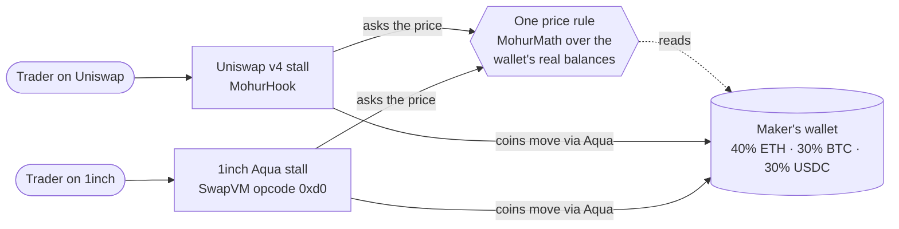
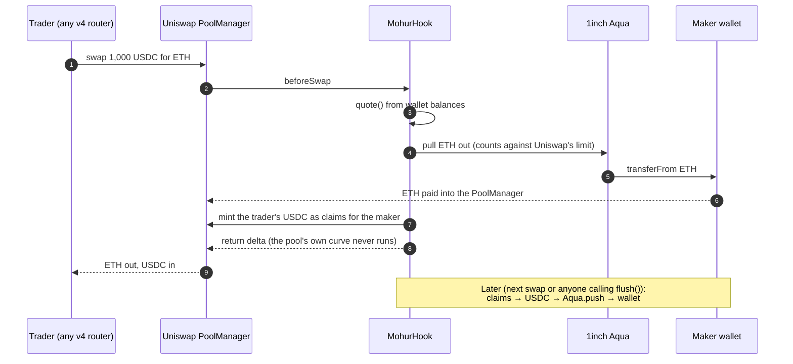
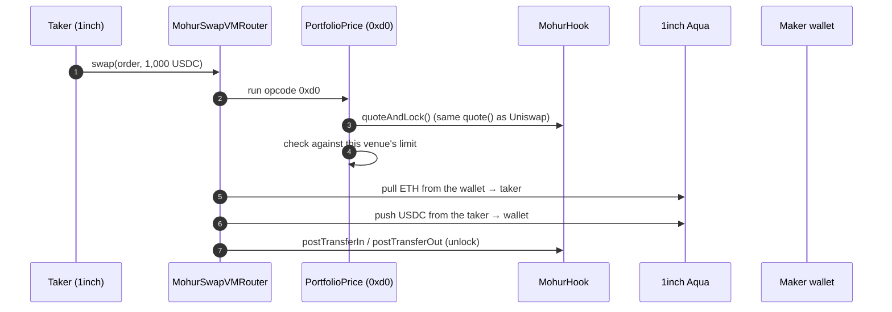
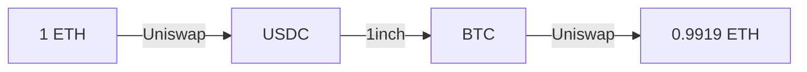
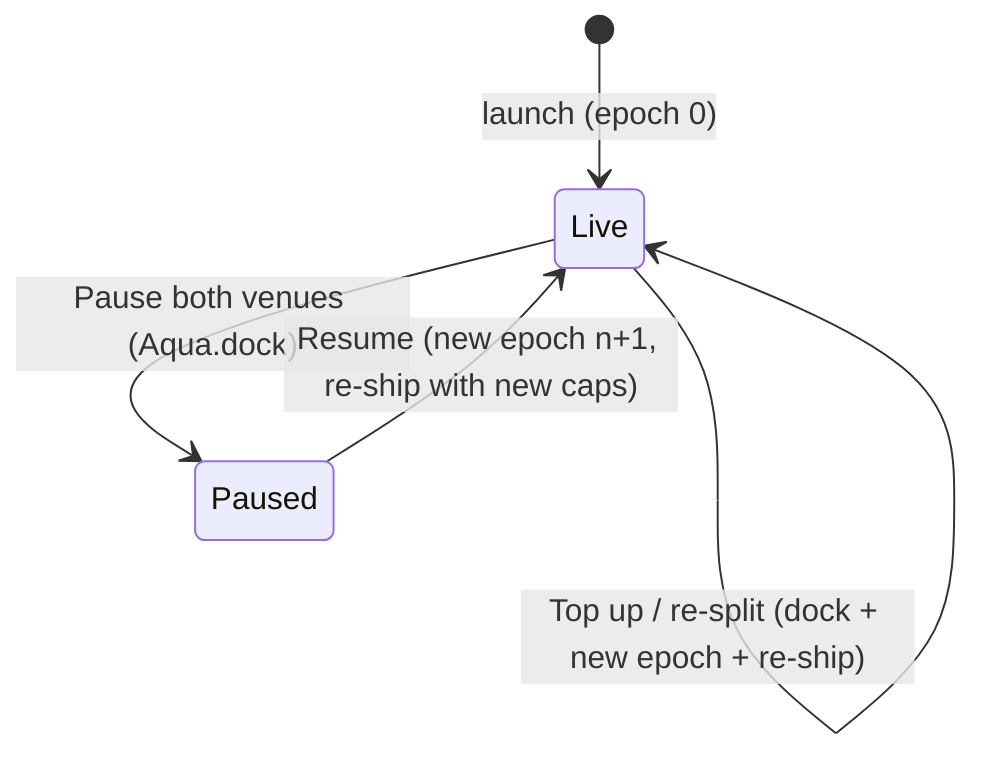
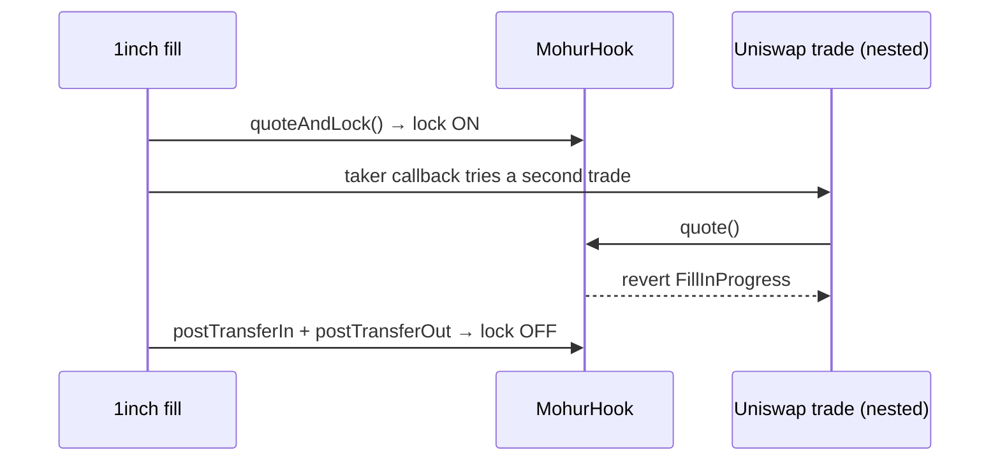
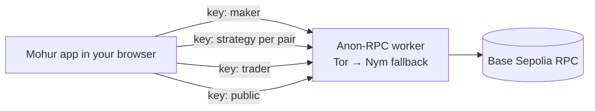

# Mohur, explained

Every part of Mohur in plain words, with a picture for each. If you only have a minute, read the first two sections. The [README](../README.md) has the judge-facing evidence and links into the code.

**Contents**
1. [The problem](#1-the-problem)
2. [The idea: one stockroom, two stalls](#2-the-idea-one-stockroom-two-stalls)
3. [The price rule](#3-the-price-rule)
4. [A trade on Uniswap v4](#4-a-trade-on-uniswap-v4)
5. [A trade on 1inch Aqua](#5-a-trade-on-1inch-aqua)
6. [Why both venues always agree](#6-why-both-venues-always-agree)
7. [Why arbitrage loops lose](#7-why-arbitrage-loops-lose)
8. [How the wallet rebalances itself](#8-how-the-wallet-rebalances-itself)
9. [Changing the mix slowly (gradual weights)](#9-changing-the-mix-slowly-gradual-weights)
10. [Venue limits, pause, top up](#10-venue-limits-pause-top-up)
11. [Launching an index](#11-launching-an-index)
12. [Safety: the fill lock](#12-safety-the-fill-lock)
13. [Privacy: Anon-RPC](#13-privacy-anon-rpc)
14. [Every screen](#14-every-screen)
15. [Every contract](#15-every-contract)
16. [How we know it works](#16-how-we-know-it-works)
17. [What Mohur does not do](#17-what-mohur-does-not-do)
18. [Glossary](#18-glossary)

---

## 1. The problem

Someone who wants to hold a basket (say 40% ETH, 30% BTC, 30% USDC) and earn trading fees on it today has to pick one of two bad options:

- **Give the coins to a pool contract** on one exchange. They leave the wallet, they earn only on that one exchange, and moving to a second exchange means splitting the money in two.
- **Run a market-making bot** on several exchanges. The two exchanges then show two different prices for the same coins, and anyone can buy cheap on one and sell dear on the other, at the maker's expense.

On top of that, watching your own positions through a normal RPC provider tells that provider exactly which wallet you are and what you care about.

## 2. The idea: one stockroom, two stalls

> Raju keeps mangoes, rice and cash in one stockroom and opens two stalls in two markets. Both stalls sell from the same stockroom and read prices off one board. A sale at one stall changes the stock, so the board, so the price at the other stall, immediately. Nobody can buy cheap at one stall and sell dear at the other.



- **The stockroom** is an ordinary self-custodial wallet. The coins never leave it to sit in a pool.
- **The stalls** are Uniswap v4 (through our hook) and 1inch Aqua (through our SwapVM instruction).
- **The board** is one function, `quote()`, that both stalls call. It has no oracle: the price comes only from what is in the wallet.

## 3. The price rule

Mohur uses the weighted-pool rule (the same family as Balancer). `w` is a token's target weight, `B` its balance in the wallet, `f` the 0.30% fee:

```
price of i in j        p = (w_i / w_j) · (B_j / B_i)
tokens out for a in    out = B_j · (1 − (B_i / (B_i + a·(1−f)))^(w_i / w_j))
```

In words: **the more of a coin the wallet holds compared with its target, the cheaper the wallet sells it.** This rule keeps the wallet's value split at its target weights.

Example from the demo: with 10 ETH, 0.3 BTC and 30,000 USDC at 40/30/30, the board says 1 ETH ≈ 4,000 USDC, purely from those balances.

## 4. A trade on Uniswap v4

Uniswap v4 lets a pool attach a **hook**. Mohur's hook replaces the pool's own curve: the pool holds nothing, and the hook fills every trade from the wallet.



- The trader's USDC is first held as **ERC-6909 claims** inside the PoolManager and counted in the wallet's balance straight away, so the very next quote on either venue already includes it.
- **Flush** turns those claims into real USDC in the wallet.
- The wallet's **only** approval is to Aqua: not to the hook, the router or the PoolManager.

## 5. A trade on 1inch Aqua

1inch Aqua lets a wallet "ship" a strategy: an order program that SwapVM runs when a taker fills it. The wallet keeps its coins; Aqua only records how much each strategy may sell (a **virtual balance**). Mohur adds one instruction to SwapVM, **opcode `0xd0` (PortfolioPrice)**, which asks the hook for the price.



The instruction also checks that the hook belongs to the order's maker, so nobody can point an order at someone else's wallet.

## 6. Why both venues always agree

Both stalls call the same `quote()` over the same balances. There is nothing to keep in sync, so there is nothing that can drift.

| Same trade | Uniswap v4 | 1inch Aqua | Difference |
|---|---|---|---|
| sell 0.1 ETH | 413.769069 USDC | 413.769069 USDC | **0 wei** |
| sell 300 USDC | 0.002736 BTC | 0.002736 BTC | **0 wei** |
| sell 0.001 BTC | 0.025639 ETH | 0.025639 ETH | **0 wei** |

*(Output of `./scripts/demo.sh` on a Base Sepolia fork. The contract tests check all 6 directions, exact-in and exact-out.)*

A fill on one venue moves the wallet, so the other venue's next quote moves with it. The Book page shows this live.

## 7. Why arbitrage loops lose

Without fees, every trade keeps the product `B_ETH^0.4 · B_BTC^0.3 · B_USDC^0.3` constant. A loop that ends in the coin it started with therefore gets back exactly what it put in, and the fee is then taken on every leg. Every rounding step also favours the maker.



**−0.81%** for a 1 ETH loop across both venues (demo), **−88 bps** for 0.1 ETH (contract test). Fuzzed loops over any mix of venues always lose. The Arbitrage page lets anyone try it for real.

## 8. How the wallet rebalances itself

When the outside market moves (say ETH goes from $4,000 to $5,000), Mohur's ETH is now cheap compared with the market. Traders buy ETH from the wallet until Mohur's price matches the market again, and at that point the wallet's value is back at 40/30/30.

| | ETH | BTC | USDC |
|---|---|---|---|
| Target | 40% | 30% | 30% |
| After ETH +25% and arbitrage (contract test) | 40.01% | 29.99% | 29.99% |

No bot, no oracle, no maker action: the traders do the rebalancing and pay the fee for it. The Book page shows what traders would do at prices you type in ("Rebalancing, live").

## 9. Changing the mix slowly (gradual weights)

If the maker switches 40/30/30 → 50/25/25 instantly, the board jumps and arbitrageurs take the whole gap in one go. With `scheduleWeights`, the target glides over a chosen time, so the market walks the wallet there in small trades that each pay the fee.

| Minutes into a 1-hour glide | 0 | 15 | 30 | 45 | 60 |
|---|---|---|---|---|---|
| ETH target weight | 40% | 42.5% | 45% | 47.5% | 50% |

| Moving $100k from 40/30/30 to 50/25/25 | Cost to the maker |
|---|---|
| Instant switch | **$1,991** |
| 50-step glide | **$25** |

*(`Reweight.t.sol`. The e2e test `09-manage` checks the glide in the app: 45% at half time, exactly 50% at the end.)*

## 10. Venue limits, pause, top up

Each venue may only sell up to a cap that the maker chooses. Aqua enforces it as a virtual balance (by default 50% of each coin for Uniswap, 25% per pair for 1inch). Coins stay in the wallet either way: the caps are permissions, not piles of coins.



- **Uniswap's cap** shrinks as it sells and grows back when its input is flushed into the wallet.
- **Epochs:** every reopen uses a new `venueNonce`, which is also the 1inch order salt. Old 1inch orders stop filling.

## 11. Launching an index

The Create and Launch pages turn any wallet into an index in six transactions, and the flow resumes where it stopped after a reload:

1. **Deploy the hook.** The browser mines a CREATE2 salt so the address carries the right v4 permission bits.
2. **Get test tokens** (testnet only).
3. **Approve Aqua.** This is the only approval the wallet ever gives.
4. **Set weights and fee.**
5. **Open the Uniswap pools and ship the Uniswap venue to Aqua.**
6. **Ship the 1inch strategy for each pair.**

The Create page's preview comes from the contracts' own math (`MohurLens.previewSpot` / `previewOutGivenIn`), not a JavaScript copy.

## 12. Safety: the fill lock

Our own review found one critical bug (C-1 in [AUDIT.md](../AUDIT.md)), and it is fixed. SwapVM calls the taker back *after* pricing a fill but *before* moving coins. In that gap the wallet still looked untouched, so a second trade on the other venue could be priced on stale balances.



| Proof of concept | Result |
|---|---|
| Two buys done honestly | **−$39.54** (the fees) |
| Second buy nested in the callback, before the fix | **+$752.92** taken from the maker |
| Same attack after the fix | reverts with `FillInProgress` |

The lock fails closed: if anything skips the unlock, pricing stays blocked for the rest of that transaction instead of leaking value.

## 13. Privacy: Anon-RPC

A normal RPC provider sees every read: which hook you check, which pairs you quote, when you look. Mohur's app sends **every** chain read through the Ethereum Foundation's Anon-RPC, which routes it through an anonymity network (Tor, falling back to Nym).



- **Isolation keys:** reads about different things go out on different circuits, so the RPC cannot link "this maker's book" to "this pair's quotes".
- **The Privacy page** lists every read with its route, label, isolation key and latency, plus the share that went through Anon-RPC.
- **Exceptions, stated in the app:** sending a transaction goes through your wallet; one bootstrap read finds the worker. On the local fork, reads go directly to the node, and the app says so.
- **Today's caveat:** the EF Tor gateway was unreachable during the hackathon, so reads fall back to Nym, which works but is slow (~50 s per read).

## 14. Every screen

| Screen | What it is for | What is real on it |
|---|---|---|
| **Home** | The idea in one picture (3D coin stacks) and the claims | Live tags read from chain |
| **Swap** | Trade against an index on either venue | Quotes from both venues, real transaction |
| **Explore** | Every index launched through the factory | Read from `HookDeployed` events |
| **Book** | One index's live state: weights, quotes on both venues, rebalancing, limits, fills | All on-chain; the market prices you type are labelled as your input |
| **My index** | The maker's controls: performance, gradual re-weight, pause, top up | On-chain; performance uses the prices you type |
| **Create / Launch** | Design an index, then launch it in six transactions | Preview from contract math |
| **Arbitrage** | Build any loop across both venues, run it for real, watch it lose | Real transaction; result must equal the quote |
| **Privacy** | Every read, its route and isolation key | Live read log |
| **How it works** | This document, shortened | |
| **Demo** | Guided six-step tour from your wallet | Real transactions, labelled demo mode |
| **Share** | A card for one index with a link to trade it | On-chain weights, prices and fills |

## 15. Every contract

| Contract | One line |
|---|---|
| `MohurMath` | The price rule, rounding toward the maker; trades capped at 30% of a balance |
| `MohurHook` | Uniswap v4 hook: prices from the wallet, pays out via Aqua, holds input as claims, fill lock, gradual weights |
| `MohurHookFactory` | One hook per maker at a CREATE2 address with the right permission bits |
| `PortfolioPrice` | SwapVM opcode `0xd0`: 1inch fills priced by the hook, venue limit enforced |
| `MohurSwapVMRouter` | Official AquaSwapVMRouter plus that one opcode |
| `MohurStrategy` | Builds the 1inch order (with the unlock hooks) that the wallet ships to Aqua |
| `MohurLens` | Read helper: whole book in one call, quotes on both venues, route quotes, previews |
| `MohurLoopRouter` | Multi-leg trades across both venues in one transaction (used by Swap, Arbitrage and Demo) |

**What it costs** (`Gas.t.sol`, measured inside a Foundry test, before refunds, excluding the 21,000 base cost of a transaction):

| Action | Gas |
|---|---|
| Swap on Uniswap v4 through MohurHook (including the test router) | ~290k |
| Fill on 1inch Aqua through opcode `0xd0` | ~216k |
| `flush()`: move Uniswap claims into the wallet | ~143k |
| `quote()`: the price both venues use | ~52k |

## 16. How we know it works

| Suite | Count | What it proves |
|---|---|---|
| Contract tests (`forge test`) | 59 | Math against 80-digit references, 0-wei venue parity, losing loops (fuzzed), self-rebalance, gradual weights, pause/resume, venue limits, the fill-lock fix, invariants, and fork tests on Base Sepolia with the official V4Quoter and Universal Router |
| Smoke checks (`scripts/smoke.sh`) | 36 | Every deployed contract answers correctly on a live chain |
| Browser tests (`npm run e2e`) | 14 specs | Every screen driven in real Chrome against a fresh fork: launch with reload, Book parity, Arbitrage, Privacy log, Demo resume, re-weight glide, top up, Share, phone layout, explanation boxes, keyboard accessibility |
| Testnet check (`npm run e2e:testnet`) | 3 | Against the deployed site: reads really go through Anon-RPC; every chain screen either works or explains itself; optional logging-proxy check |
| One-click demo (`./scripts/demo.sh`) | | Prints the key numbers straight from chain |

## 17. What Mohur does not do

- **It does not reduce LVR.** When the market moves, the traders who rebalance you capture that move; you earn the fee. The landing page shows the cost.
- **Round trips don't always lose a full fee.** They always lose, with a proven floor, but not always the full 0.30%.
- **Uniswap input waits as claims** until it is flushed (priced in immediately, but 1inch cannot sell it before then).
- **Raising a venue cap starts a new epoch**, which docks and re-ships the venues.
- **One trade moves at most 30% of a balance.**
- **Use a dedicated wallet.** Prices read the wallet's live balances, so spending index coins elsewhere moves the quotes.
- **Not externally audited.** Our own review is in [AUDIT.md](../AUDIT.md).
- **Testnet only.** Test tokens with no value.

## 18. Glossary

| Term | Meaning |
|---|---|
| **Index / weights** | The target split of the wallet's value, e.g. 40/30/30 |
| **Maker** | The wallet owner who runs the index |
| **Venue** | A place traders can fill against the index: Uniswap v4 or 1inch Aqua |
| **Hook** | A contract Uniswap v4 calls during a swap; Mohur's replaces the pool's curve |
| **Aqua** | 1inch's shared-liquidity layer: coins stay in the wallet, strategies get virtual balances |
| **SwapVM / opcode** | 1inch's order-execution machine; `0xd0` is Mohur's added pricing instruction |
| **Venue limit (cap)** | The most a venue may sell, enforced by Aqua |
| **Claims (ERC-6909)** | Uniswap's IOU tokens; Mohur holds trader input as claims until `flush()` |
| **Epoch / venueNonce** | A version number for the venue setup; reopening bumps it |
| **LVR** | Loss-versus-rebalancing: what a passive maker loses to better-informed traders when prices move |
| **Anon-RPC** | The Ethereum Foundation's private RPC access over Tor or Nym |
| **Isolation key** | A label that sends unrelated reads over separate circuits so they can't be linked |
